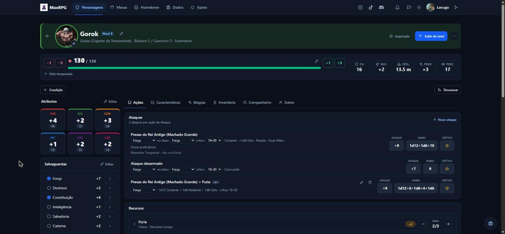
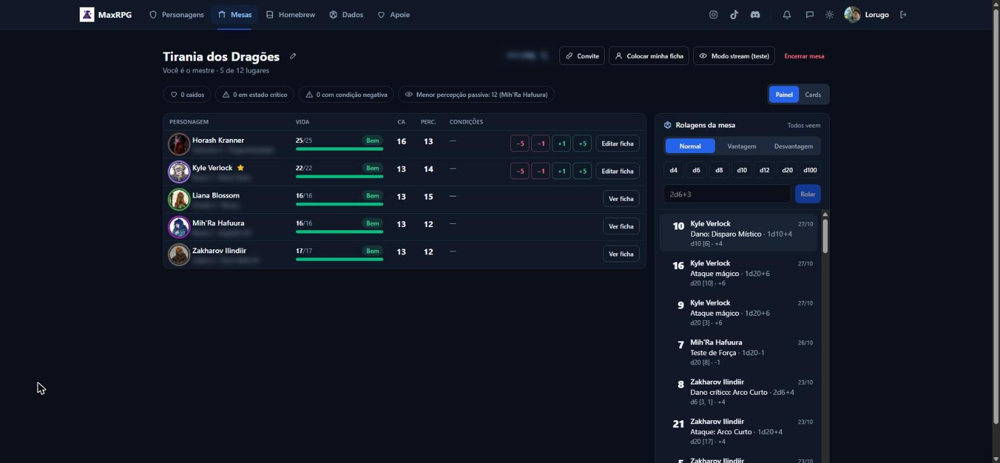
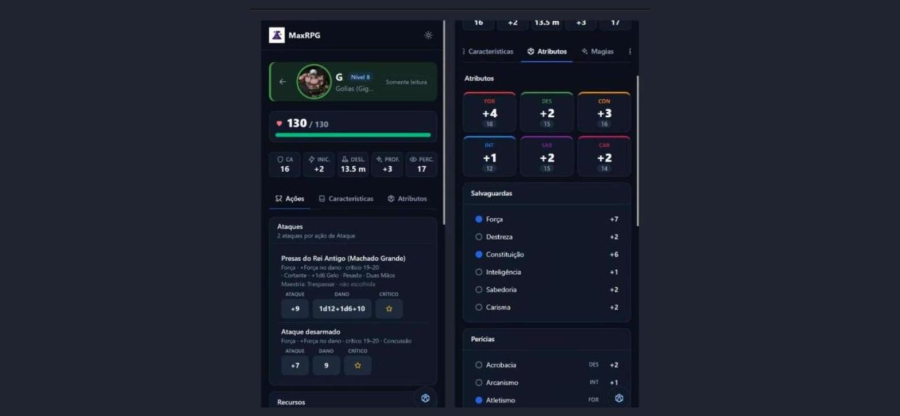
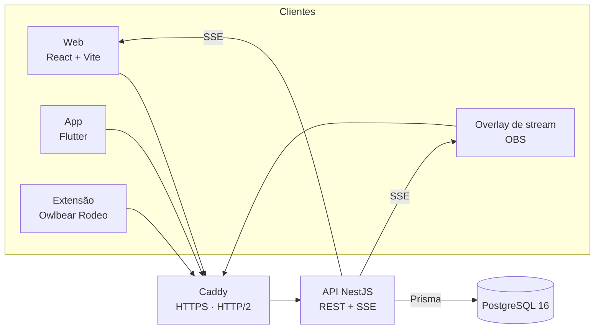

<h1 align="center">MaxRPG</h1>

  <b>Ficha digital de D&D 5e com mesas em tempo real</b> 
  <a href="https://maxrpg.io">maxrpg.io</a> · 800 usuários · web e app Flutter

> **Repositório de vitrine.** O código-fonte do MaxRPG é privado. Aqui estão a arquitetura, a stack, as decisões técnicas e prints do produto em produção.

  

  
  

---

## O que o produto faz

- **Ficha automatizada:** atributos, salvaguardas, 18 perícias com proficiência e especialização, CA, iniciativa e percepção passiva recalculados a cada mudança.
- **Multiclasse pelas regras do PHB 2024**, com dados de vida separados por classe e controle de recursos por descanso curto e longo.
- **Ataques** com bônus e dano calculados, dano extra, faixa de crítico e maestria de armas.
- **Mesas em tempo real:** o mestre cria a mesa, os jogadores entram por código e todos veem fichas, vida e rolagens ao vivo.
- **Overlay para streamers:** página com token próprio, atualizada em tempo real, para usar no OBS.
- **Homebrew:** raças, origens, talentos, magias, equipamentos, subclasses e formas de animal próprias.
- **Ficha em PDF** nos modelos oficiais (PHB 2014 e 2024).
- **Extensão para o Owlbear Rodeo** (protótipo): o jogador cola o link da ficha e vê PV, CA e rolagens dentro do mapa virtual.

## Arquitetura

- **API em módulos NestJS:** auth, users, characters, sheets, homebrew, rules, tables, presence, stream, notices, feedback, supporters, activity e admin.
- **Tempo real com Server-Sent Events:** as mesas e o overlay de stream recebem eventos do servidor sem polling e sem a complexidade de WebSocket, já que o fluxo é quase todo do servidor para o cliente.
- **Regras como dados:** classes, raças, antecedentes, magias, equipamentos, talentos e formas de animal ficam em tabelas no banco (Prisma), separadas da lógica de cálculo.
- **Autenticação:** JWT com refresh token, login com Google e recuperação de senha por e-mail.
- **Documentação da API** com Swagger.

## Stack

| Camada | Tecnologias |
|---|---|
| Backend | NestJS, TypeScript, Prisma, PostgreSQL 16, Swagger, JWT, Google OAuth, Nodemailer, pdf-lib, sharp |
| Web | React, Vite, TanStack Query, Zustand, React Hook Form + Zod, Radix UI, Framer Motion |
| Mobile | Flutter |
| Infra | Docker Compose, Caddy, VPS Linux, scripts de backup e restauração |
| Comunidade | Automação do servidor do Discord em Node.js, sem dependências, com testes |

## Decisões técnicas

- **SSE em vez de WebSocket** nas mesas: menos estado no servidor e reconexão nativa do navegador.
- **HTTP/2 em vez de HTTP/3 no Caddy:** em algumas redes o QUIC caía no meio do uso e a página perdia arquivos. Desligar o HTTP/3 resolveu sem custo perceptível.
- **Bloqueio de robôs de IA** que ignoram o `robots.txt`, direto no proxy.
- **Deploy simples e reproduzível:** um `docker compose` com banco, API e proxy, mais scripts de atualização, backup e restauração da VPS.

## Autor

**Luis Rodrigo Lima Rodrigues**, desenvolvedor backend. Criei e mantenho o MaxRPG de ponta a ponta: produto, backend, web, app, deploy e comunidade.

[LinkedIn](https://www.linkedin.com/in/luisrodrigolima) · [GitHub](https://github.com/Lorugo01) · [maxrpg.io](https://maxrpg.io)
